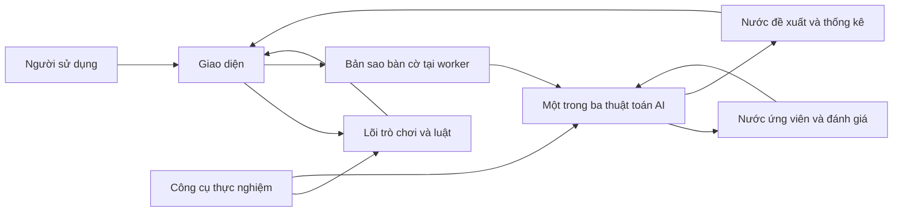
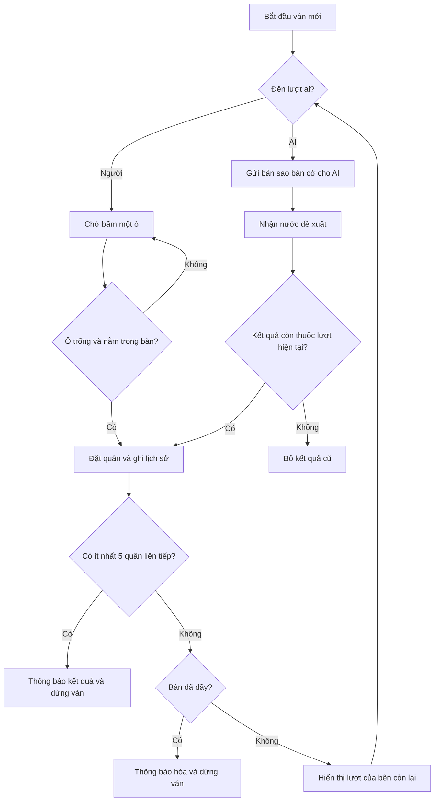
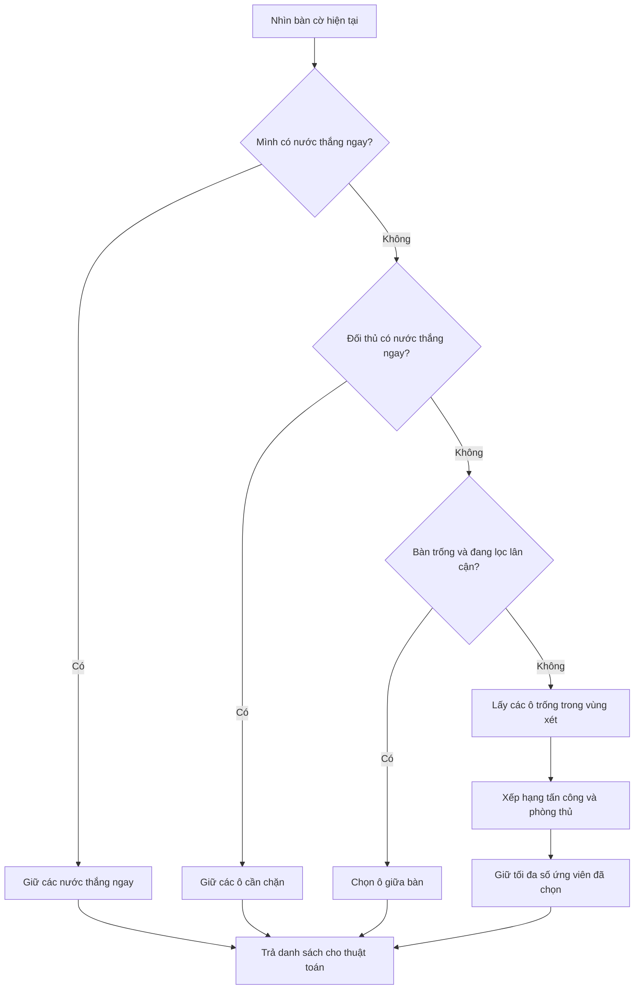
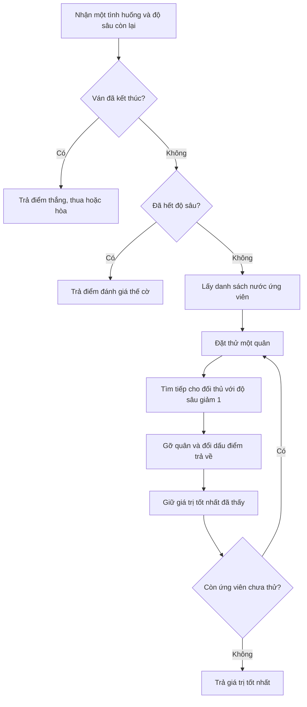
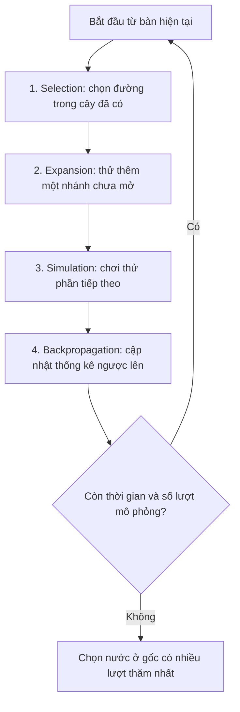
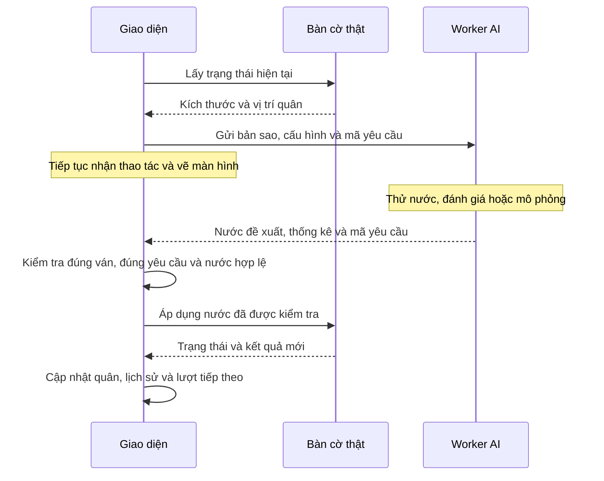
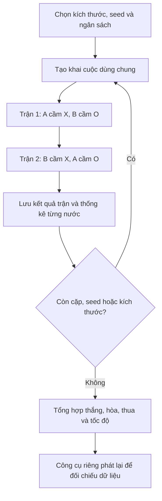

# Hiểu dự án FIVE: trò chơi hoạt động và AI suy nghĩ như thế nào?

Tài liệu này dành cho cả người **chưa từng học lập trình**. Bạn chỉ cần biết cách đặt quân X/O trên bàn cờ. Các thuật ngữ sẽ được giải thích trước khi dùng, và mỗi phần đều trả lời ba điều: chương trình làm gì, làm bằng cách nào, và vì sao cách đó có tác dụng.

Nội dung mô tả **phiên bản đang có trong dự án**, gồm bàn cờ 7×7, 9×9, 11×11, ba thuật toán AI, giao diện và công cụ thực nghiệm. Đây là tài liệu giải thích để học và thuyết trình; các bước chạy ngắn gọn nằm trong [README.md](README.md).

**Cách đọc:** đọc mục 1–8 để hiểu nền tảng; mục 9–11 giải thích ba thuật toán; mục 12–15 nối mọi thứ thành chương trình hoàn chỉnh; mục 16–18 giúp sử dụng và tra cứu.

Các sơ đồ trong khối `mermaid` có thể hiện thành hình khi trình xem Markdown hỗ trợ Mermaid. Nếu trình xem chỉ hiện chữ, hãy đọc phần “Đọc sơ đồ” ngay bên dưới; các ví dụ dạng cây và bàn cờ bằng ký tự vẫn đọc được trực tiếp.

## Mục lục

1. [Dự án đang giải quyết điều gì?](#tong-quan)
2. [Luật chơi: khi nào thắng, thua hoặc hòa?](#luat-choi)
3. [Các bộ phận và vai trò của chúng](#kien-truc)
4. [Luồng một ván chơi từ đầu đến cuối](#luong-van-choi)
5. [Máy tính nhớ bàn cờ và kiểm tra kết quả ra sao?](#trang-thai)
6. [Vì sao AI không thử hết mọi tương lai?](#khong-gian)
7. [Chọn các nước đáng thử](#ung-vien)
8. [Chấm điểm một thế cờ chưa kết thúc](#danh-gia)
9. [Backtracking, Minimax và Negamax](#backtracking)
10. [Alpha-beta: bỏ những việc không ảnh hưởng quyết định](#alpha-beta)
11. [MCTS: học từ các lượt chơi thử trong lúc suy nghĩ](#mcts)
12. [Độ sâu, thời gian và các giới hạn](#gioi-han)
13. [Vì sao giao diện vẫn phản hồi khi AI đang suy nghĩ?](#giao-dien)
14. [Theo dõi trọn một nước đi qua hệ thống](#vi-du)
15. [Kiểm thử và so sánh các thuật toán](#thuc-nghiem)
16. [Cách sử dụng và đọc các con số](#su-dung)
17. [Bản đồ mã nguồn để tra cứu](#ma-nguon)
18. [Câu hỏi thường gặp và từ điển ngắn](#hoi-dap)

<a id="tong-quan"></a>

## 1. Dự án đang giải quyết điều gì?

Hãy tưởng tượng bạn đang chơi cờ 5 quân liên tiếp với một người bạn. Mỗi lần đến lượt, người đó nhìn bàn cờ, xem mình có thể thắng ngay không, kiểm tra đối thủ đang đe dọa gì, rồi suy nghĩ một số nước tiếp theo.

Dự án làm ba việc tương ứng:

- **Tổ chức ván chơi:** hiển thị bàn cờ, nhận thao tác và quản lý lượt X/O.
- **Làm trọng tài:** ngăn nước đi sai luật, xác định thắng hoặc hòa.
- **Đóng vai người chơi AI:** dùng một trong ba cách suy nghĩ để chọn ô đặt quân.

Ngoài ra, dự án cho các AI đấu với nhau và lưu số liệu để trả lời: cách nào tìm nhanh hơn, xét ít tình huống hơn, hoặc thắng nhiều hơn trong một cấu hình cụ thể?

Trong tài liệu này, **thuật toán** nghĩa là một quy trình có các bước rõ ràng để giải quyết công việc. Ví dụ, “xem có nước thắng ngay không; nếu có thì đi vào đó” cũng là một quy trình rất đơn giản.

AI của dự án không dùng mô hình ngôn ngữ, không cần mạng Internet và không cần dữ liệu huấn luyện. Nó dựa vào luật, cách chấm điểm và việc thử các diễn biến có thể xảy ra.

<a id="luat-choi"></a>

## 2. Luật chơi: khi nào thắng, thua hoặc hòa?

| Nội dung | Quy tắc của dự án |
|---|---|
| Kích thước | Chọn 7×7, 9×9 hoặc 11×11 |
| Người đi trước | X |
| Một lượt | Đặt đúng một quân vào một ô trống |
| Điều kiện thắng | Có ít nhất 5 quân của mình liên tiếp theo hàng ngang, hàng dọc hoặc đường chéo |
| Chuỗi dài hơn 5 | Vẫn thắng |
| Bị chặn hai đầu | Vẫn thắng nếu đã có ít nhất 5 quân liên tiếp |
| Hòa | Bàn đầy và không có người thắng |
| Sau khi kết thúc | Không được đặt thêm quân |

Dấu `.` trong các ví dụ sau là ô trống:

```text
X X X X X       → X thắng: 5 quân liên tiếp.
X X X X X X     → X thắng: 6 quân cũng thỏa điều kiện ít nhất 5.
O X X X X X O   → X vẫn thắng: hai đầu bị chặn không làm mất chiến thắng.
X X . X X       → Chưa thắng: có khoảng trống ngắt chuỗi.
```

Ví dụ 6 quân chỉ có thể xuất hiện trong một ván hợp lệ nếu nước cuối nối các nhóm thành chuỗi 6 quân. Nếu đã có 5 quân ở lượt trước, ván phải dừng từ lượt trước đó.

Trò chơi không áp dụng các luật cấm bổ sung của một số biến thể cờ khác, như cấm tạo hai hàng ba hoặc cấm chuỗi dài hơn 5. Đây là bộ luật đã chọn cho dự án này.

**Vì sao cần chốt luật trước khi làm AI?** Cùng một thế cờ có thể thắng trong bộ luật này nhưng chưa thắng trong bộ luật khác. Mọi thuật toán phải dùng chung một trọng tài thì việc chơi và so sánh mới có ý nghĩa.

<a id="kien-truc"></a>

## 3. Các bộ phận và vai trò của chúng

Có thể hình dung chương trình như một bàn thi đấu có người tiếp nhận thao tác, trọng tài, người suy nghĩ và thư ký ghi kết quả.

| Bộ phận | Hình dung đời thường | Công việc |
|---|---|---|
| Giao diện | Mặt bàn và bảng điều khiển | Vẽ quân cờ, nhận cú bấm, hiện thông báo |
| Lõi trò chơi | Trọng tài và sổ ghi bàn cờ | Lưu vị trí quân, quản lý lượt, xác định kết quả |
| Sinh nước ứng viên | Người lập danh sách lựa chọn | Lọc ra các ô AI sẽ cân nhắc |
| Hàm đánh giá | Người chấm tình thế | Ước lượng bên nào đang thuận lợi |
| Thuật toán AI | Người ra quyết định | Thử các khả năng rồi chọn một nước |
| Worker AI | Bàn suy nghĩ riêng | Chạy AI tách khỏi việc vẽ và nhận thao tác |
| Công cụ thực nghiệm | Người tổ chức giải đấu | Chạy nhiều trận, đo và lưu số liệu |
| Bộ kiểm thử | Người kiểm tra chất lượng | Đặt ra các tình huống để phát hiện lỗi |



**Đọc sơ đồ:** người dùng tương tác với giao diện; giao diện nhờ lõi trò chơi ghi nhận nước đi. Khi cần AI, một bản sao bàn cờ được gửi sang nơi suy nghĩ riêng. AI trả về một đề xuất, rồi giao diện mới áp dụng đề xuất đó vào ván thật. Công cụ thực nghiệm có thể dùng trực tiếp luật và AI mà không mở cửa sổ.

**Vì sao tách thành nhiều phần?** Nếu muốn sửa màu quân cờ, ta không cần sửa thuật toán. Nếu muốn so sánh hai AI, ta không cần thao tác chuột từng ván. Mọi chế độ chơi vẫn dùng chung bộ luật.

<a id="luong-van-choi"></a>

## 4. Luồng một ván chơi từ đầu đến cuối

### 4.1. Lúc mở chương trình

Khi chạy `python main.py`, chương trình tạo cửa sổ, vẽ bàn cờ và chờ người dùng chọn thiết lập. Ván mới chỉ bắt đầu khi bấm **Bắt đầu / Ván mới**.

Người dùng chọn kích thước, chế độ chơi, thuật toán cho mỗi bên AI và các giới hạn suy nghĩ. Chương trình kiểm tra các giá trị có hợp lệ không. Ví dụ, thời gian âm hoặc chữ nhập vào ô độ sâu sẽ bị từ chối.

Nếu cấu hình hợp lệ, chương trình tạo bàn trống, xóa lịch sử của ván trước và cho X đi trước. Nếu X là AI, AI bắt đầu suy nghĩ; nếu X là người, chương trình chờ bấm vào bàn cờ.

### 4.2. Vòng lặp của ván chơi



**Đọc sơ đồ:** mỗi vòng chỉ cần lấy một nước hợp lệ, đặt quân, kiểm tra kết quả và chuyển sang người còn lại. Nhánh người và nhánh AI khác nhau ở cách tìm nước đi; cả hai đều đi qua cùng luật đặt quân và xác định kết quả.

Sơ đồ trình bày thứ tự theo ý nghĩa của ván chơi. Trong mã nguồn, thao tác đặt quân cũng cập nhật sẵn thông tin bên sẽ đi tiếp, kể cả khi vừa xác định người thắng. Cờ kết thúc ván sẽ ngăn bên đó thực hiện thêm nước nào.

### 4.3. Ba chế độ dùng cùng luồng này

- **Người vs Người:** cả X và O đều chờ thao tác chuột.
- **Người vs AI:** một bên chờ chuột, bên kia gọi thuật toán.
- **AI vs AI:** sau mỗi nước, chương trình tự gọi AI của bên tiếp theo.

Không cần viết ba bộ luật riêng. Chương trình chỉ thay đổi câu trả lời cho câu hỏi “bên đang đến lượt là người hay AI?”.

<a id="trang-thai"></a>

## 5. Máy tính nhớ bàn cờ và kiểm tra kết quả ra sao?

### 5.1. Bàn cờ là một danh sách thông tin

Trên màn hình bạn thấy các ô vuông. Trong bộ nhớ, chương trình lưu mỗi ô bằng một giá trị:

| Giá trị | Ý nghĩa |
|---:|---|
| 0 | Ô trống |
| 1 | Quân X |
| -1 | Quân O |

Ví dụ, hàng `X . O .` có thể được lưu thành `1, 0, -1, 0`. Toàn bộ bàn cờ được lưu theo từng hàng nối tiếp nhau.

Ngoài vị trí quân, chương trình còn nhớ đến lượt ai, đã đi bao nhiêu nước, nước vừa đánh nằm ở đâu và có người thắng hay chưa. Tập thông tin đó gọi là **trạng thái bàn cờ**: một bản mô tả đầy đủ của tình huống hiện tại.

### 5.2. Nhận diện chiến thắng bằng các đoạn 5 ô

Chương trình chuẩn bị sẵn danh sách mọi đoạn gồm đúng 5 ô liên tiếp theo bốn hướng. Ví dụ một hàng 7 ô chứa ba đoạn ngang như sau:

```text
Vị trí:  1 2 3 4 5 6 7
Đoạn A: [1 2 3 4 5]
Đoạn B:   [2 3 4 5 6]
Đoạn C:     [3 4 5 6 7]
```

Với mỗi đoạn, chương trình đếm số quân X và O. Nếu một đoạn có 5 quân X, X thắng; có 5 quân O, O thắng.

**Vì sao kiểm tra đoạn 5 ô vẫn phát hiện chuỗi 6 hoặc 7 quân?** Bất kỳ chuỗi liên tiếp dài hơn 5 đều chứa ít nhất một đoạn con dài đúng 5. Ví dụ 6 quân X chứa hai đoạn gồm 5 quân X.

### 5.3. Chỉ cập nhật những đoạn bị ảnh hưởng

Giả sử bạn đặt X vào một ô. Những hàng, cột và đường chéo không đi qua ô đó vẫn y nguyên. Vì thế, chỉ các đoạn chứa ô vừa đặt mới cần cập nhật số quân và điểm.

Trước mỗi nước hợp lệ, ván chưa có người thắng. Do đó, nếu nước vừa đi tạo chiến thắng mới, chiến thắng ấy phải đi qua ô vừa đặt. Đây là lý do chương trình có thể kiểm tra một vùng thông tin nhỏ thay vì xét lại toàn bộ bàn mỗi lần.

**Ví dụ đời thường:** khi sửa một ô trong bảng tính, bạn chỉ cần tính lại các phép tính phụ thuộc ô đó, không cần làm lại mọi công việc khác.

### 5.4. Đặt thử và gỡ lại

Khi suy nghĩ, AI phải giả định “nếu đi vào ô A thì sao?”. Chương trình có hai thao tác bổ sung nhau:

1. **Đặt quân:** ghi thêm quân, cập nhật số quân trong các đoạn, điểm và lượt đi.
2. **Gỡ quân vừa thử:** khôi phục ô trống, điểm, lượt đi và thông tin trước đó.

Mọi thông tin cần khôi phục đều được lưu trong lịch sử. Nhờ vậy, AI có thể thử nhiều khả năng mà không làm tình huống này lẫn sang tình huống khác.

Trong GUI, việc thử diễn ra trên bản sao ở worker; bàn thật chỉ nhận nước cuối cùng. Khi thực nghiệm chạy trực tiếp trên bàn hiện tại, thuật toán có trách nhiệm gỡ toàn bộ nước đã thử trước khi trả kết quả.

<a id="khong-gian"></a>

## 6. Vì sao AI không thử hết mọi tương lai?

Bàn 11×11 có 121 ô. Nếu xét mọi nước từ bàn trống, chỉ ba lần đặt quân đầu đã có:

```text
Lượt 1: 121 lựa chọn
Lượt 2: mỗi lựa chọn trước có 120 cách đáp lại
Lượt 3: mỗi tình huống tiếp tục có 119 cách đi

121 × 120 × 119 = 1.727.880 chuỗi gồm ba nước
```

Đó mới chỉ là “mình đi, đối thủ đi, mình đi tiếp”, còn rất xa lúc ván kết thúc. Cứ nhìn thêm một lượt, số khả năng lại nhân lên. Hiện tượng này thường được gọi là **bùng nổ số khả năng**.

Vì vậy, dự án dùng kết hợp nhiều cách:

| Cách làm | Tác dụng | Điều phải chấp nhận |
|---|---|---|
| Chỉ chọn một số nước đáng thử | Giảm số nhánh ngay từ đầu | Có thể bỏ sót một nước tốt |
| Giới hạn số lượt nhìn trước | Dừng trước khi cây quá lớn | Có thể chưa thấy bẫy ở xa |
| Chấm điểm thế cờ chưa kết thúc | Vẫn chọn được nước khi chưa biết kết quả cuối | Điểm chỉ là ước lượng |
| Alpha-beta | Bỏ những nhánh đã chứng minh không ảnh hưởng quyết định | Cần tổ chức việc tìm kiếm đúng |
| MCTS | Dồn lượt chơi thử vào các hướng cần khảo sát | Kết quả phụ thuộc lượng và chất lượng mô phỏng |
| Giới hạn thời gian | Người chơi không phải chờ vô hạn | Một lượt suy nghĩ có thể dừng trước khi đủ sâu |

Điểm cần phân biệt: **lọc bớt nước ứng viên có thể mất phương án tốt; cắt tỉa Alpha-beta đúng cách giữ nguyên giá trị Minimax của cùng cây tìm kiếm.** Hai việc này có lý do và mức đảm bảo khác nhau.

<a id="ung-vien"></a>

## 7. Chọn các nước đáng thử

Một ô trống được phép đi theo luật gọi là **nước hợp lệ**. Một ô nằm trong danh sách AI chuẩn bị xem xét gọi là **nước ứng viên**. Nước ứng viên luôn phải hợp lệ, nhưng có thể chỉ chiếm một phần các nước hợp lệ.

### 7.1. Thứ tự chọn ứng viên



**Đọc sơ đồ:** ưu tiên việc khẩn cấp trước, sau đó mới lọc các nước phát triển bình thường. Luồng này dùng chung cho cả Backtracking, Alpha-beta và MCTS.

### 7.2. Vì sao thắng ngay được ưu tiên trước chặn?

Nếu mình có thể thắng ở lượt hiện tại thì ván kết thúc ngay. Đối thủ không còn lượt tiếp theo để thực hiện đe dọa của họ. Do đó, chương trình kiểm tra nước thắng của mình trước.

Nếu mình chưa có nước thắng nhưng đối thủ có một ô giúp hoàn thành chuỗi 5 quân ở lượt sau, đi chỗ khác sẽ để đối thủ thắng ngay. AI tập trung vào các ô cần chặn.

Ví dụ đoạn `O O O O .` có một ô trống hoàn thành 5 quân O. Nếu đang đến lượt X và X chưa thể thắng ngay, ô đó là điểm cần xem xét đầu tiên.

Nếu đối thủ có hai đe dọa độc lập, chặn một ô có thể vẫn thua ở ô kia. Bộ lọc giúp nhận ra việc cấp bách; nó không bảo đảm mọi thế cờ đều cứu được.

### 7.3. Vùng lân cận bán kính 2

Thông thường, những nước cạnh khu vực đã có quân dễ tạo chuỗi hoặc ngăn đối thủ hơn một ô hoàn toàn xa trận đấu. Với bán kính 2, chương trình lấy ô có khoảng cách hàng không quá 2 và khoảng cách cột không quá 2 so với **ít nhất một quân đã có**.

```text
Một quân X và vùng xung quanh nó:

  . . . . .
  . . . . .
  . . X . .
  . . . . .
  . . . . .

Mỗi dấu chấm đều nằm trong phạm vi xét của quân X ở giữa.
Gần mép bàn, phần nằm ngoài bàn được bỏ đi.
```

Nếu bàn có nhiều quân, các vùng lân cận được hợp lại. Không chỉ xét quanh nước vừa đi.

Đây là một giả định thực dụng về nước đi đáng quan tâm, không phải định lý rằng mọi nước ở xa đều vô ích. Trong công cụ thực nghiệm, có thể bỏ lọc này để xét toàn bộ ô trống.

### 7.4. Giới hạn số lượng và thứ tự ưu tiên

Nếu còn quá nhiều ô, chương trình chấm ưu tiên và giữ lại các ô có thứ hạng cao. GUI mặc định giữ tối đa **12 ứng viên ở mỗi tình huống được xét**, không phải 12 ô cố định cho toàn ván.

Điểm ưu tiên dựa trên hai điều: đặt vào đó giúp mình phát triển bao nhiêu, và chiếm ô đó ngăn đối thủ phát triển bao nhiêu. Công thức hiện tại đặt trọng số 2 cho phần tấn công và 1 cho phần phòng thủ. Nếu bằng nhau, ưu tiên gần trung tâm hơn, rồi dùng thứ tự ô để quyết định ổn định.

Những nước thắng/chặn ngay đã phát hiện ở đầu luồng **không bị cắt bớt bởi giới hạn số lượng**. Ví dụ hai ô chặn khẩn cấp vẫn được giữ dù giới hạn ứng viên đặt là 1.

Nếu mỗi tình huống chỉ có khoảng 12 lựa chọn, nhìn trước ba lượt có khoảng `12 × 12 × 12 = 1.728` nhánh cuối thay vì hơn 1,7 triệu trong ví dụ xét toàn bàn. Đây chỉ là ước tính để thấy mức giảm; số thực tế còn phụ thuộc quân đã có, nước bắt buộc và việc ván kết thúc sớm.

<a id="danh-gia"></a>

## 8. Chấm điểm một thế cờ chưa kết thúc

### 8.1. Vì sao phải ước lượng?

Nếu chỉ biết “thắng = tốt, thua = xấu”, AI sẽ không biết chọn gì khi mọi tình huống nó nhìn tới đều chưa kết thúc. Vì vậy, cần một thước đo tạm thời: bên nào có nhiều cơ hội tạo chuỗi 5 hơn?

Thước đo đó gọi là **heuristic**, có thể hiểu là “quy tắc chấm điểm dựa trên kinh nghiệm thiết kế”. Điểm cao cho thấy thế cờ được chương trình đánh giá thuận lợi hơn, không phải xác suất thắng đã được chứng minh.

### 8.2. Chấm từng đoạn 5 ô

Chương trình dùng lại các đoạn 5 ô đã chuẩn bị khi kiểm tra thắng. Một đoạn có cả X lẫn O không thể trở thành 5 quân cùng màu, vì quân đã đặt không bị di chuyển hoặc lấy khỏi bàn. Vì thế đoạn ấy nhận điểm 0.

Một đoạn chỉ chứa quân của một bên và ô trống nhận điểm theo bảng:

| Số quân của cùng một bên trong đoạn | Điểm | Ý nghĩa trực quan |
|---:|---:|---|
| 0 | 0 | Chưa có lợi thế trong đoạn này |
| 1 | 2 | Bắt đầu có tiềm năng |
| 2 | 16 | Có cơ sở để phát triển |
| 3 | 128 | Đe dọa đáng chú ý |
| 4 | 4.096 | Chỉ còn thiếu một ô để hoàn thành đoạn |
| 5 | 1.000.000 | Đã tạo chuỗi thắng |

Ví dụ các đoạn **riêng lẻ**:

```text
X X . . .  → 16 điểm cho X.
X . X X .  → 128 điểm cho X, dù các quân chưa liền nhau.
X X . X X  → 4.096 điểm cho X; đi vào giữa là đủ 5.
X X O . .  → 0 điểm cho đoạn này vì đã bị hai bên chia sẻ.
```

Một đoạn bị chặn có điểm 0 không có nghĩa mọi quân trong đoạn đều vô dụng. Chúng vẫn có thể thuộc các đoạn khác theo hàng, cột hoặc đường chéo.

### 8.3. Từ điểm từng đoạn đến điểm toàn bàn

Chương trình cộng điểm các đoạn của X và trừ điểm các đoạn của O:

```text
Điểm theo góc nhìn X = Tổng điểm các đoạn của X − Tổng điểm các đoạn của O
Điểm theo góc nhìn O = − Điểm theo góc nhìn X
```

Ví dụ minh họa: tổng của X là 4.200, tổng của O là 1.000 thì điểm theo X là +3.200, theo O là -3.200. Đây là cùng một thế cờ nhìn từ hai bên đối lập.

Một hàng có hai đầu mở có thể đóng góp qua nhiều đoạn 5 ô chồng nhau. Nhờ đó, khả năng phát triển ở nhiều hướng có thể được phản ánh mà không cần viết riêng một quy tắc cho từng mẫu. Tuy nhiên, cách chấm này chưa nhận diện đầy đủ mọi bẫy kết hợp phức tạp.

### 8.4. Điểm ước lượng và kết quả thật có vai trò khác nhau

Khi Minimax gặp một ván đã kết thúc, nó dùng điểm thắng/thua trực tiếp. Khi chạm độ sâu giới hạn mà ván chưa kết thúc, nó mới dùng heuristic, được giới hạn trong khoảng từ -500.000 đến +500.000.

Điểm thắng thật có độ lớn gần 1.000.000, nên một thế cờ “trông rất hứa hẹn” không được xếp cao hơn một chiến thắng đã xác định trong cây tìm kiếm.

Các trọng số 2, 16, 128 và 4.096 là **tham số do người thiết kế chọn**, nhằm làm đe dọa gần thắng quan trọng hơn tiềm năng xa. Chúng không phải luật cờ và chưa được chứng minh là bộ trọng số tốt nhất.

### 8.5. Hai loại điểm dễ nhầm

| Loại điểm | Câu hỏi mà nó trả lời |
|---|---|
| Điểm ưu tiên nước đi | Nên thử ô nào trước hoặc giữ ô nào trong danh sách ngắn? |
| Điểm đánh giá thế cờ | Sau khi đã đi một số lượt, tình thế này tốt hay xấu cho bên đang xét? |

Hai loại điểm cùng dựa vào các đoạn 5 ô nhưng phục vụ hai công đoạn khác nhau. Nước đứng đầu danh sách ưu tiên chưa chắc là nước cuối cùng được chọn sau khi suy nghĩ sâu hơn.

<a id="backtracking"></a>

## 9. Backtracking, Minimax và Negamax

Ba tên này xuất hiện cùng nhau vì chúng mô tả ba khía cạnh của cùng cách tìm kiếm trong dự án.

| Tên | Hiểu đơn giản |
|---|---|
| Backtracking, hay quay lui | Thử một lựa chọn, đi sâu xem tiếp, rồi quay lại để thử lựa chọn khác |
| Minimax | Chọn nước có kết quả tốt nhất khi giả định đối thủ cũng chọn tốt nhất cho họ |
| Negamax | Viết Minimax gọn hơn bằng cách đổi dấu điểm khi đổi góc nhìn X/O |

Thuật toán được đặt tên **Backtracking** trong GUI chính là **Minimax tìm kiếm bằng quay lui, chưa có cắt tỉa Alpha-beta**.

### 9.1. Cây tìm kiếm là gì?

Từ một bàn cờ, AI có thể đi A hoặc B. Sau A, đối thủ có thể trả lời A1 hoặc A2. Sau mỗi câu trả lời, lại có thêm các lựa chọn khác. Vẽ các khả năng nối tiếp nhau sẽ được một hình giống cây phân nhánh.

Mỗi **nút** là một tình huống bàn cờ. Mỗi **nhánh** là một nước đi nối hai tình huống. Nút đầu tiên là bàn hiện tại, thường gọi là gốc.

```text
Bàn hiện tại: AI cần chọn A hoặc B
│
├── AI đi A
│   ├── Đối thủ đáp A1 → điểm +6 cho AI
│   └── Đối thủ đáp A2 → điểm +2 cho AI
│
└── AI đi B
    ├── Đối thủ đáp B1 → điểm +4 cho AI
    └── Đối thủ đáp B2 → điểm -3 cho AI
```

Các điểm trong cây này là số minh họa cho cách quyết định, không phải số liệu đo của một ván cụ thể.

### 9.2. Vì sao chọn A dù nhánh B cũng có điểm dương?

AI không được tự chọn câu trả lời của đối thủ. Nếu đối thủ chơi tốt cho họ, họ sẽ chọn tình huống bất lợi hơn cho AI:

- Sau A, đối thủ chọn +2 thay vì +6. Giá trị đảm bảo của A trong cây đang xét là **+2**.
- Sau B, đối thủ chọn -3 thay vì +4. Giá trị tương ứng của B là **-3**.
- AI so sánh +2 với -3 và chọn **A**.

Đó là ý tưởng Minimax: tại lượt mình, lấy lựa chọn tốt nhất; tại lượt đối thủ, giả định họ chọn điều tốt nhất cho họ, tức xấu nhất cho mình.

**Vì sao hợp lý?** Cờ là trò đối kháng: mục tiêu của hai bên xung đột nhau. Nếu chỉ nghĩ “đối thủ sẽ đi nước có lợi cho mình”, AI rất dễ chọn một kế hoạch chỉ thành công khi đối thủ mắc sai lầm.

### 9.3. Quay lui được áp dụng thế nào?

Để dựng cây trong suy nghĩ, chương trình không cần giữ mọi bàn cờ giả định cùng lúc. Nó lần lượt:

1. Đặt thử A lên bàn đang xét.
2. Đặt thử A1 của đối thủ.
3. Chấm điểm tình huống cuối hoặc tiếp tục nhìn sâu hơn.
4. Gỡ A1, đưa bàn trở lại đúng trạng thái sau A.
5. Thử A2, ghi kết quả rồi gỡ A2.
6. Gỡ A, quay lại bàn ban đầu.
7. Lặp lại với B.



**Đọc sơ đồ:** một tình huống được giải bằng cách thử các tình huống nhỏ hơn phía sau nó. Khi biết kết quả ở phía sâu, chương trình đem điểm ngược về phía gốc để chọn nước. Việc một công việc tự gọi lại cùng cách làm cho tình huống nhỏ hơn được gọi là **đệ quy**.

Mã nguồn dùng cơ chế đảm bảo gỡ quân kể cả khi bị ngắt vì hết thời gian. Nhờ vậy, một lần tìm kiếm chưa xong không để lại quân giả định trên bàn.

### 9.4. Độ sâu được tính bằng từng lượt đặt quân

| Độ sâu | AI nhìn trước đến đâu? |
|---:|---|
| 1 | Mình đi một nước |
| 2 | Mình đi, đối thủ trả lời |
| 3 | Mình đi, đối thủ trả lời, mình đi tiếp |
| 4 | Hai lần đi của mỗi bên |

Độ sâu 4 không có nghĩa AI nhìn trước 4 nước của riêng mình. Mỗi lần một bên đặt quân là một mức sâu.

### 9.5. Negamax: đổi góc nhìn bằng đổi dấu

Trong trò chơi này, nếu một thế cờ có điểm +100 cho X thì có điểm -100 cho O. Do đó, thay vì viết hai quy trình riêng “X lấy lớn nhất” và “O lấy nhỏ nhất”, ta có thể luôn để bên đang đi tìm điểm lớn nhất **theo góc nhìn của chính bên đó**.

Sau khi hỏi đối thủ “tình thế này tốt cho bạn bao nhiêu?”, ta đổi dấu để chuyển sang “tình thế này tốt cho mình bao nhiêu?”.

```text
Điểm một nước cho mình = − điểm mà đối thủ đánh giá sau nước đó
```

Negamax không phải một cách đánh khác Minimax. Nó là cách tổ chức cùng một lập luận, phù hợp với thang điểm đối xứng của dự án.

### 9.6. Điều Backtracking làm được và chưa bảo đảm

Khi chạy xong một độ sâu, nó chọn đúng theo quy tắc Minimax **trên tập nước ứng viên và thang đánh giá đang dùng**. Tuy nhiên, một nước tốt nằm ngoài tập ứng viên hoặc một bẫy xuất hiện sau độ sâu giới hạn vẫn có thể bị bỏ lỡ.

Đây là thuật toán nền tốt để kiểm tra và so sánh, nhưng số nhánh tăng nhanh khi tăng độ sâu hoặc số ứng viên.

<a id="alpha-beta"></a>

## 10. Alpha-beta: bỏ những việc không ảnh hưởng quyết định

### 10.1. Ý tưởng bằng một ví dụ

Giả sử AI đã xét hết A và biết rằng đối thủ phản ứng tốt nhất thì A vẫn cho điểm +2. AI có một phương án đã xác định giá trị là +2.

Tiếp theo, khi xét B, AI phát hiện đối thủ có một cách trả lời khiến điểm của AI thành -3. Dù B còn những câu trả lời khác chưa xem, đối thủ đã có thể ép AI xuống -3 hoặc thấp hơn. B không thể tốt hơn A theo quy tắc Minimax.

```text
AI đang chọn nước
│
├── A: đã xét đủ, giá trị là +2
│
└── B: đến lượt đối thủ chọn
    ├── B1 → -3 cho AI
    ├── B2 → bỏ qua
    └── B3 → bỏ qua

Vì đối thủ chọn điều xấu nhất cho AI:
Giá trị của B ≤ -3 < +2 = giá trị của A.
```

Ngay cả nếu B2 có điểm +100 cho AI, đối thủ vẫn có thể chọn B1. Vì thế xem tiếp B2 và B3 không thay đổi việc loại B khỏi lựa chọn tốt nhất ở gốc.

### 10.2. Alpha và beta dùng để làm gì?

Hai giá trị alpha và beta ghi lại những giới hạn mà việc tìm kiếm đã biết. Có thể hiểu chúng như “mốc đủ tốt đã tìm được” và “giới hạn khiến phía còn lại không cần xem tiếp”, theo góc nhìn của nhánh đang xét.

Khi các giới hạn cho thấy nhánh hiện tại không thể thay đổi quyết định đang cần đưa ra, chương trình dừng xét phần còn lại của nhánh. Trong mã nguồn, điều kiện đó được kiểm tra bằng `alpha >= beta`.

Người đọc không cần nhớ công thức để nắm cơ chế: **đã có đủ bằng chứng một lựa chọn không giúp cải thiện quyết định thì không cần khám phá hết lựa chọn ấy**.

### 10.3. Áp dụng trong dự án

Backtracking và Alpha-beta dùng cùng một lõi tìm kiếm trong [ai/minimax.py](ai/minimax.py). Phiên bản Alpha-beta bật thêm việc cập nhật giới hạn và dừng nhánh; phiên bản Backtracking không bật phần đó.

Chúng vẫn dùng cùng luật, cùng hàm chấm điểm và cùng cơ chế sinh nước đi. Nhờ vậy, khi đặt cùng độ sâu, cùng tập ứng viên, cùng thứ tự duyệt và cho đủ thời gian hoàn thành, giá trị Minimax trả về phải giống nhau.

Nếu có nhiều nước đồng điểm, nguyên tắc chung không bắt buộc mọi cách cài đặt phải trả đúng cùng một ô. Điều quan trọng là ô được chọn đạt giá trị tốt nhất trong cây đang xét.

### 10.4. Vì sao xét nước tốt trước giúp cắt được nhiều hơn?

Muốn sớm loại một phương án yếu, trước hết phải có một phương án đủ tốt để so sánh. Xét các nước có triển vọng trước thường giúp thiết lập giới hạn tốt sớm hơn, từ đó bỏ được nhiều nhánh phía sau.

Đây là lý do việc xếp thứ tự ứng viên có ích ngay cả khi không giảm số lượng ứng viên.

### 10.5. Ví dụ đo từ chính dự án

Trong dữ liệu [depth_comparison.csv](results/quick/depth_comparison.csv), ở bàn 7×7, seed 11, độ sâu 3, giới hạn 8 ứng viên:

| Thuật toán | Giá trị Minimax | Số nút đã xét |
|---|---:|---:|
| Backtracking | 3.982 | 585 |
| Alpha-beta | 3.982 | 102 |

Ở tình huống này, Alpha-beta xét ít hơn 483 nút, tức khoảng **82,6%**, mà vẫn cho cùng giá trị. Đây là một phép đo cụ thể; mức tiết kiệm ở thế cờ khác có thể khác.

### 10.6. Cùng độ sâu và cùng thời gian là hai câu hỏi khác nhau

**Cùng độ sâu:** Alpha-beta giúp giảm công việc để đi đến cùng kết luận Minimax.

**Cùng thời gian:** nhờ giảm công việc, Alpha-beta có thể hoàn thành độ sâu lớn hơn. Khi đó nó nhìn thấy thêm các tình huống mà Backtracking chưa kịp thấy, nên có thể chọn nước khác.

Alpha-beta không tự sửa những hạn chế của heuristic hoặc việc lọc ứng viên. Nó giúp tìm trên cây đã chọn hiệu quả hơn.

<a id="mcts"></a>

## 11. MCTS: học từ các lượt chơi thử trong lúc suy nghĩ

### 11.1. Cách tiếp cận

MCTS viết đầy đủ là **Monte Carlo Tree Search**, có thể hiểu là tìm kiếm trên cây bằng các lượt mô phỏng có yếu tố ngẫu nhiên.

Thay vì cố xét đủ mọi nhánh đến một độ sâu chung, AI chơi thử nhiều diễn biến. Nó ghi lại hướng nào có kết quả tốt, đồng thời vẫn dành lượt thử cho những hướng chưa biết rõ.

Hình dung bạn đang chọn một đường đi: bạn khảo sát vài đường, thấy đường A khá tốt nhưng B mới khảo sát một lần. Bạn cần cân bằng giữa tiếp tục theo hướng có triển vọng và tìm hiểu hướng còn ít thông tin.

“Học” ở đây là cập nhật thống kê trong **lượt suy nghĩ hiện tại**. Phiên bản dự án tạo cây MCTS mới mỗi lần chọn nước; nó không giữ kinh nghiệm lâu dài qua các ván hay tự huấn luyện một mô hình.

### 11.2. Bốn giai đoạn trong một lượt mô phỏng



**Đọc sơ đồ:** mỗi vòng chọn một hướng, mở thêm cây khi có thể, chơi thử rồi ghi lại kết quả. Sau nhiều vòng, thống kê ở các nước đầu tiên giúp AI quyết định nước thật.

Nếu gặp một tình huống đã kết thúc thì không cần mở nhánh hoặc chơi tiếp; kết quả cuối được dùng trực tiếp.

### 11.3. Giai đoạn 1 — Selection: chọn đường đi trong cây

Một nhánh đã được thử nhiều lần sẽ có số lượt thăm và điểm thưởng trung bình. Chương trình dùng UCT để cân bằng:

- **Khai thác:** ưu tiên nhánh có kết quả trung bình tốt.
- **Khám phá:** dành cơ hội cho nhánh còn ít lượt thử, vì đánh giá hiện tại có thể chưa chắc chắn.

Công thức thực tế có dạng:

```text
Điểm chọn nhánh = Điểm thưởng trung bình
                + C × căn bậc hai[ ln(N) / n ]

N: số lần đã thăm tình huống cha.
n: số lần đã thăm nhánh con.
C: mức ưu tiên khám phá, mặc định khoảng 1,414.
```

Bạn không cần tính căn hay logarit để hiểu ý nghĩa: phần cộng thêm sẽ khuyến khích xét một nhánh còn ít dữ liệu. Công thức này dùng cho các nhánh đã có ít nhất một lượt mô phỏng hoàn tất.

### 11.4. Giai đoạn 2 — Expansion: mở thêm một khả năng

Nếu tình huống đang xét còn nước ứng viên chưa mở thành nhánh, MCTS chọn ngẫu nhiên một nước trong số đó và tạo một nút mới.

Cây vì thế lớn lên dần theo các lượt suy nghĩ, thay vì dựng sẵn toàn bộ mọi tương lai. Tập nước có thể mở vẫn chịu bộ lọc ứng viên đã giải thích ở mục 7.

### 11.5. Giai đoạn 3 — Simulation: chơi tiếp một ván giả định

Từ tình huống vừa đến, chương trình cho hai bên đi tiếp các nước được chọn ngẫu nhiên trong danh sách ứng viên. Vì danh sách đã ưu tiên thắng/chặn ngay, các bước ngẫu nhiên này vẫn có một số hiểu biết chiến thuật cơ bản.

Đây không phải việc bốc ngẫu nhiên từ mọi ô trên bàn ở mọi lượt. Nó là mô phỏng ngẫu nhiên **trong tập nước đã được lọc**.

Một ván mô phỏng dừng khi có kết quả hoặc đã đi đủ số bước mô phỏng cho phép. Mặc định là tối đa **60 bước từ lúc bắt đầu phần chơi tiếp**, không phải tối đa 60 lượt mô phỏng cho cả lần AI suy nghĩ.

### 11.6. Giai đoạn 4 — Backpropagation: ghi kết quả ngược lên

Giả sử một lần chơi thử kết thúc với X thắng. Chương trình cập nhật tất cả các nút nằm trên đường đã chọn trong cây:

| Kết quả cho bên đang được tính thưởng | Thưởng |
|---|---:|
| Thắng | 1 |
| Hòa | 0,5 |
| Thua | 0 |

Mỗi nút tăng thêm một lượt thăm và cộng thêm thưởng phù hợp. Chẳng hạn 10 lượt thử gồm 6 thắng, 2 hòa, 2 thua cho một bên có điểm thưởng trung bình:

```text
(6 × 1 + 2 × 0,5 + 2 × 0) / 10 = 0,7
```

Con số 0,7 là điểm trung bình trong các lần thử đó. Nó **không bảo đảm xác suất thắng trước người thật là 70%**, vì kết quả phụ thuộc cách mô phỏng, số mẫu và đối thủ.

Chỉ các nút của cây đang được lưu mới nhận thống kê. Các nước chơi tiếp trong phần mô phỏng không đồng loạt được biến thành hàng loạt nút mới trong cùng một vòng.

### 11.7. Vì sao góc nhìn X/O rất quan trọng?

Nếu ở lượt O mà thuật toán vẫn ưu tiên kết quả tốt cho X, nó sẽ mô phỏng một đối thủ tự giúp X thắng. Kết quả như vậy không đáng tin.

Trong dự án, mỗi nút lưu thưởng theo **người vừa đánh nước để đến nút đó**. Vì vậy, khi một người đang chọn giữa các nước của mình, các nút con đều chứa kết quả theo góc nhìn của người đó.

Ví dụ một đường đi có cả nước X và nước O, và kết quả cuối là X thắng: các nút đại diện nước X nhận thưởng 1, các nút đại diện nước O nhận 0. Đây là cách giữ mục tiêu đối kháng nhất quán khi cập nhật ngược lên cây.

### 11.8. Nếu chơi thử 60 bước vẫn chưa kết thúc thì sao?

MCTS dùng điểm đánh giá ở mục 8 rồi chuyển nó về thang từ 0 đến 1:

```text
Thưởng ước lượng = 0,5 + 0,5 × tanh(điểm đánh giá / 8192)
```

Ở đây `tanh` chỉ đóng vai trò một cách “nén điểm”:

- Điểm đánh giá 0 trở thành 0,5: chưa thiên về bên nào.
- Điểm dương trở thành số lớn hơn 0,5.
- Điểm âm trở thành số nhỏ hơn 0,5.
- Điểm có độ lớn cao hơn đưa giá trị gần 1 hoặc gần 0 hơn.

Vì vậy, MCTS trong dự án **có dùng heuristic cho mô phỏng bị cắt ngắn**. Nó không phải phiên bản luôn chơi ngẫu nhiên tới hết ván.

Cần phân biệt hai tình huống: nếu dừng vì đủ 60 bước, mô phỏng được chấm ước lượng và cập nhật; nếu bị ngắt do hết thời gian hoặc bị hủy, lượt mô phỏng đang dở không được cập nhật vào cây.

### 11.9. Chọn nước thật sau khi đã thử nhiều lần

Ở gốc, chương trình chọn nước có **nhiều lượt thăm nhất**. Nếu số lượt thăm bằng nhau thì chọn nước có thưởng trung bình cao hơn.

Cách này giúp tránh quyết định chỉ dựa trên một nhánh có vài mẫu may mắn. Ví dụ minh họa:

| Nước | Lượt thăm | Thưởng trung bình |
|---|---:|---:|
| A | 100 | 0,65 |
| B | 8 | 0,875 |

Theo quy tắc cuối cùng của chương trình, A được chọn. B có điểm mẫu cao hơn, nhưng mới được thử ít lần. Nếu chưa có mô phỏng nào hoàn tất, chương trình trả nước hợp lệ đầu tiên trong danh sách ứng viên làm phương án dự phòng.

<a id="gioi-han"></a>

## 12. Độ sâu, thời gian và các giới hạn

### 12.1. Tìm sâu dần để luôn có một kết quả đã hoàn thành

Backtracking và Alpha-beta khi chơi trên GUI không bắt đầu ngay bằng độ sâu lớn nhất. Chúng thử độ sâu 1, rồi 2, rồi 3, tiếp tục đến khi hết thời gian hoặc đạt trần sâu.

Ví dụ dưới đây là tình huống minh họa, không phải phép đo:

```text
Hoàn thành độ sâu 1 → lưu nước A.
Hoàn thành độ sâu 2 → cập nhật thành nước B.
Hoàn thành độ sâu 3 → cập nhật thành nước C.
Đang tìm ở độ sâu 4 thì hết giờ → trả nước C.
```

**Vì sao không lấy ngay nước có vẻ tốt nhất ở độ sâu 4 đang dở?** Một số lựa chọn có thể đã được xem kỹ, một số chưa được xem. So sánh chúng như thể đã hoàn thành cùng mức tìm kiếm sẽ dễ thiên lệch. Chương trình giữ kết quả của vòng sâu đã xét xong.

Nếu ngay độ sâu 1 cũng chưa xong, vẫn có nước dự phòng hợp lệ. Khi đó thống kê ghi độ sâu hoàn thành bằng 0 và chưa có điểm tìm kiếm hoàn chỉnh.

### 12.2. Các giá trị mặc định trên GUI

| Thiết lập | Giá trị lúc mở GUI | Ý nghĩa |
|---|---:|---|
| Độ sâu tối đa | 4 | Trần nhìn trước cho Backtracking và Alpha-beta |
| Giây / nước AI | 0,75 | Ngân sách tìm nước đi cho cả ba thuật toán |
| Lượt MCTS tối đa | 1.500 | Trần số vòng mô phỏng của MCTS |
| Số ứng viên / nút | 12 | Giới hạn các lựa chọn bình thường tại mỗi tình huống |
| Seed ngẫu nhiên | 42 | Giá trị khởi đầu để điều khiển việc chọn ngẫu nhiên |

MCTS dừng khi chạm giới hạn thời gian hoặc số lượt mô phỏng, tùy điều kiện nào đến trước. Nó không dùng trường “độ sâu tối đa” để cắt cây theo cách Minimax dùng.

Backtracking và Alpha-beta không dùng trường “lượt MCTS tối đa”. Chúng còn có thể dừng sớm khi tìm ra giá trị thắng/thua chắc chắn trong cây đang xét.

Đây là mặc định của **giao diện**. Lớp cấu hình dùng trực tiếp trong mã và công cụ thực nghiệm có thể chọn giá trị khác; khi đọc kết quả đo, phải xem cấu hình đi cùng dữ liệu.

### 12.3. Thời gian là giới hạn mềm

AI kiểm tra đồng hồ giữa các bước tính toán. Nếu một bước đang chạy khi hết giờ, thời gian thực tế có thể vượt nhẹ ngân sách trước lần kiểm tra tiếp theo.

Ngoài thời gian AI tìm kiếm, GUI còn có thời gian gửi dữ liệu, khởi tạo worker và vẽ màn hình. Vì vậy, 0,75 giây tìm kiếm không hứa chính xác 0,75 giây từ lúc người chơi bấm đến khi quân AI hiện ra.

### 12.4. Seed giúp tái lập điều gì?

Seed giống như chọn điểm bắt đầu cho một chuỗi bốc thăm do máy tính tạo ra. Nếu cùng bàn cờ, cùng seed, cùng cấu hình và chạy đúng cùng số vòng MCTS mà không giới hạn thời gian, kết quả có thể được tái lập.

Nếu dùng giới hạn thời gian, tải máy có thể làm số vòng hoàn thành khác nhau. Cùng seed khi đó chưa đủ để bảo đảm cùng nước cuối.

Trong GUI, seed của từng lượt AI bằng seed người dùng chọn cộng số quân đang có. Cách này giữ quy tắc tạo seed rõ ràng cho từng lượt; nó không phải một cơ chế học từ các ván trước.

<a id="giao-dien"></a>

## 13. Vì sao giao diện vẫn phản hồi khi AI đang suy nghĩ?

### 13.1. Tách người nhận thao tác khỏi người tính toán

Nếu một người vừa phải suy nghĩ hàng nghìn tình huống vừa phải nghe mọi yêu cầu bấm nút, công việc dễ bị nghẽn. Dự án chia thành hai nơi thực hiện:

- **Tiến trình giao diện:** vẽ bàn cờ, xử lý thao tác, quản lý ván thật.
- **Tiến trình AI:** nhận một bản sao bàn cờ và tập trung chọn nước.

“Tiến trình” có thể hiểu là một công việc được hệ điều hành quản lý riêng. Hai tiến trình trao đổi thông điệp, thay vì cùng sửa trực tiếp một bàn cờ trong bộ nhớ.

### 13.2. Một lần giao việc diễn ra thế nào?



**Đọc sơ đồ:** thời gian chạy từ trên xuống. AI chỉ gửi đề xuất về; giao diện còn phải kiểm tra rồi mới ghi vào bàn thật. Trong khi chờ, giao diện vẫn có thể nhận lệnh tạm dừng hoặc tạo ván mới.

Worker đặt kết quả vào một hàng đợi, giống như hộp thư. Giao diện lên lịch kiểm tra hộp thư khoảng mỗi 40 mili giây khi đang chờ. Đây là cách tránh đứng yên chờ AI trả lời bằng một lệnh gây chặn giao diện.

### 13.3. Vấn đề kết quả cũ

Giả sử AI đang nghĩ cho ván A, bạn bấm Ván mới để tạo ván B. Nếu kết quả của A đến muộn rồi được đặt lên B, chương trình sẽ đánh sai tình huống.

Để ngăn điều đó, mỗi yêu cầu mang hai thông tin nhận diện:

1. Mã thế hệ ván: đổi khi bắt đầu ván mới.
2. Số thứ tự yêu cầu: đổi khi giao một lượt suy nghĩ mới.

Kết quả chỉ được dùng nếu khớp yêu cầu đang chờ và ván hiện tại chưa bị tạm dừng. Đây giống như kiểm tra số bàn và số đơn trước khi giao món ăn.

### 13.4. Tạm dừng, tiếp tục và đóng cửa sổ

Khi tạm dừng, chương trình báo cho worker dừng. Nếu nó chưa thoát sau khoảng chờ ngắn, tiến trình đó bị kết thúc. Bản sao suy nghĩ của nó được bỏ đi, còn bàn thật vẫn giữ nguyên.

Khi tiếp tục, AI suy nghĩ lại từ trạng thái hiện tại. Nó không nối tiếp chính xác cây đang xây dở trước lúc dừng.

Khi tạo ván mới hoặc đóng cửa sổ, tác vụ AI hiện tại cũng được hủy. Cơ chế này vừa tránh nhận kết quả cũ, vừa tránh để AI tiếp tục chiếm tài nguyên sau khi người dùng đã rời ván.

### 13.5. Điều gì được phép thay đổi bàn thật?

Giao diện chỉ ghi một nước khi đến đúng lượt, ván chưa kết thúc và ô đó hợp lệ. Với nước AI, nó còn kiểm tra mã yêu cầu trước khi áp dụng. Các nước thử nằm bên worker không tự xuất hiện trên màn hình.

Nhờ vậy, “AI thử 10.000 tình huống” không có nghĩa bàn thật đã đi 10.000 nước. Ván thật vẫn chỉ nhận **một nước cuối cùng**.

<a id="vi-du"></a>

## 14. Theo dõi trọn một nước đi qua hệ thống

Giả sử đang chơi bàn 7×7, người dùng cầm O, AI cầm X. Sau tám lượt đặt quân, bàn có dạng sau. Hàng và cột được đánh số từ 1:

```text
       Cột
       1 2 3 4 5 6 7
Hàng 1 X . X . X . X
     2 . . . . . . .
     3 . . . . . . .
     4 . . . . . . .
     5 . . . . . . .
     6 . . . . . . .
     7 O O O O . . .

Đã có 4 quân X và 4 quân O; bây giờ đến lượt X.
```

Người dùng vừa đặt quân O tại hàng 7, cột 4. Ta theo dõi từng bước:

| Bước | Bộ phận thực hiện | Điều xảy ra |
|---:|---|---|
| 1 | Giao diện | Xác định vị trí bấm là hàng 7, cột 4 |
| 2 | Lõi trò chơi | Ghi quân O, cập nhật các đoạn chứa ô đó |
| 3 | Lõi trò chơi | Thấy O mới có 4 quân liền nhau, chưa thắng; bàn chưa đầy |
| 4 | Giao diện | Nhận biết đến lượt X và X là AI |
| 5 | Worker | Nhận bản sao bàn cờ cùng cấu hình tìm kiếm |
| 6 | Bộ sinh ứng viên | Kiểm tra X có nước thắng ngay không: không có |
| 7 | Bộ sinh ứng viên | Phát hiện O có thể thắng tại hàng 7, cột 5 |
| 8 | Thuật toán AI | Chỉ còn ô chặn đó trong danh sách gốc, nên đề xuất hàng 7, cột 5 |
| 9 | Giao diện | Nhận kết quả, kiểm tra còn đúng ván và ô vẫn trống |
| 10 | Lõi trò chơi | Đặt X tại hàng 7, cột 5; chưa có bên nào thắng |
| 11 | Giao diện | Vẽ quân X, ghi lịch sử, hiển thị đến lượt O |

Hàng cuối sau nước AI:

```text
O O O O X . .
```

Đe dọa thắng ngay của O đã bị chặn. AI không xóa quân đối thủ; nó chiếm ô đối thủ cần để hoàn thành chuỗi.

**Vì sao cả ba thuật toán đều chọn giống nhau trong ví dụ này?** Vì chúng dùng chung bộ lọc và ở gốc chỉ còn một ô chặn. Đây là minh họa cho việc toàn hệ thống phối hợp, chưa phải tình huống đủ khó để phân biệt chất lượng ba cách tìm kiếm. Khi có nhiều nước ứng viên, cách lựa chọn giữa chúng mới thể hiện khác biệt rõ hơn.

<a id="thuc-nghiem"></a>

## 15. Kiểm thử và so sánh các thuật toán

### 15.1. Kiểm thử và thực nghiệm trả lời hai câu hỏi khác nhau

**Kiểm thử** hỏi: “Chương trình có làm đúng điều đã quy định không?”. Ví dụ, một hàng 5 quân phải được xác định là thắng, và ô đã có quân không được đánh thêm.

**Thực nghiệm** hỏi: “Khi chạy đúng, phương pháp nào có đặc điểm gì?”. Ví dụ, Alpha-beta giảm được bao nhiêu nút, hoặc MCTS thắng bao nhiêu trận trong ngân sách 0,04 giây/nước.

AI thua một trận không tự động có nghĩa chương trình lỗi. Nó có thể thua vì thuật toán, heuristic hoặc ngân sách chưa đủ tốt. Ngược lại, AI thắng nhiều trận cũng không chứng minh mọi phần của chương trình đều đúng.

### 15.2. Các nhóm kiểm tra trong dự án

| Nhóm | Ví dụ câu hỏi được kiểm tra |
|---|---|
| Luật | Thắng ngang, dọc, hai đường chéo có đúng trên cả ba kích thước? |
| Trường hợp biên | Chuỗi 6 quân, hai đầu bị chặn và bàn đầy được xử lý đúng không? |
| Nước không hợp lệ | Có từ chối ô ngoài bàn, ô đã có quân và nước sau khi kết thúc không? |
| Đặt/gỡ | Sau khi thử và gỡ, bàn, điểm và lượt đi có được phục hồi không? |
| AI | Có tìm nước thắng ngay hoặc chặn thua ngay ở các thế kiểm tra không? |
| Minimax | Backtracking và Alpha-beta có cùng giá trị ở các bài đối chứng không? |
| MCTS | Có giữ đúng góc nhìn X/O và lặp lại kết quả khi cố định số vòng/seed không? |
| Hủy tác vụ | Hết giờ hoặc hủy có làm hỏng trạng thái không? |
| GUI | Chọn O có khiến AI X đi trước; pause/reset có bỏ được kết quả cũ không? |

Phiên bản này có **22 bài kiểm thử lõi/AI và 5 bài kiểm thử GUI**. Trong lần xác minh khi triển khai, cả 27 bài đều đạt. Một bài có thể chứa nhiều trường hợp nhỏ, chẳng hạn kiểm tra tất cả hướng thắng trên cả ba kích thước.

Kiểm thử tự động là bằng chứng cho các tình huống đã kiểm tra; nó không phải chứng minh chương trình không thể có lỗi ở mọi tình huống khác.

### 15.3. So sánh cùng độ sâu

Mục tiêu là đo hiệu quả cắt tỉa Alpha-beta. Quy trình:

1. Tạo một thế cờ dùng chung bằng một chuỗi khai cuộc hợp lệ.
2. Cho Backtracking và Alpha-beta xét cùng độ sâu.
3. Giữ giống nhau cách lọc ứng viên và thứ tự duyệt.
4. Bỏ giới hạn thời gian và không tìm sâu dần, để cả hai hoàn thành đúng mức cần đo.
5. So sánh giá trị Minimax, số nút và thời gian.

Thế cờ đối chứng hiện được tạo sau 10 nước khai cuộc. Bộ nhanh dùng 3 kích thước, 2 seed và 2 độ sâu là 2, 3:

```text
3 kích thước × 2 seed × 2 độ sâu = 12 cặp đối chứng
Mỗi cặp chạy 2 thuật toán → 24 dòng kết quả.
```

Nếu giá trị Minimax của hai thuật toán khác nhau trong cùng điều kiện này, chương trình thực nghiệm sẽ báo lỗi để xem lại.

### 15.4. Cho các AI đấu cùng ngân sách thời gian

Mục tiêu tiếp theo là quan sát chất lượng thi đấu. Có ba cặp:

- Backtracking gặp Alpha-beta.
- Backtracking gặp MCTS.
- Alpha-beta gặp MCTS.

Mỗi cặp đấu hai trận với cùng khai cuộc: trận đầu một thuật toán cầm X, trận sau đổi lại. Việc đổi bên giúp giảm ảnh hưởng của lợi thế đi trước.

Công cụ thực nghiệm chuẩn bị 4 nước khai cuộc, mỗi bên đã có 2 quân, rồi mới giao bàn cho các AI tiếp tục. Cùng kích thước và seed thì các cặp dùng cùng khai cuộc. Các nước khai cuộc được lưu lại để có thể phát lại chính xác.



**Đọc sơ đồ:** cùng điều kiện được dùng cho một cặp trận đổi bên; sau đó lặp lại cho các seed, đối thủ và kích thước khác. Phần phát lại là một bước kiểm tra dữ liệu bằng lệnh riêng, không phải một trận AI suy nghĩ lại từ đầu.

Bộ nhanh đã chạy dùng 0,04 giây tìm kiếm mỗi nước, trần độ sâu 20 cho Minimax, trần 1.000.000 vòng cho MCTS và giới hạn 8 ứng viên. Với 2 seed:

```text
3 kích thước × 3 cặp thuật toán × 2 seed × 2 cách chia X/O = 36 trận.
```

Giới hạn thời gian là điều kiện so sánh chung. Không phải nước nào cũng dùng hết thời gian, vì có thể dừng sớm do kết quả đã rõ trong cây hoặc chạm trần khác.

### 15.5. Dữ liệu nào được lưu và dùng để làm gì?

| Tệp | Cách hiểu không cần lập trình |
|---|---|
| [metadata.json](results/quick/metadata.json) | Tờ ghi điều kiện thí nghiệm: máy, cấu hình, seed và tình trạng chạy xong |
| [depth_comparison.csv](results/quick/depth_comparison.csv) | Bảng đối chiếu hai thuật toán ở cùng độ sâu |
| [games.csv](results/quick/games.csv) | Sổ kết quả: ai gặp ai, ai thắng, bao nhiêu nước |
| [moves.csv](results/quick/moves.csv) | Nhật ký từng nước AI, kèm thời gian và công việc tìm kiếm |
| [summary.csv](results/quick/summary.csv) | Bảng tổng hợp thắng/hòa/thua và thống kê theo kích thước, thuật toán |

CSV là tệp bảng dữ liệu dạng văn bản, có thể mở bằng phần mềm bảng tính. JSON là cách ghi thông tin có tên và cấu trúc, giống một phiếu có nhiều mục và danh sách con.

### 15.6. Phát lại kiểm tra được điều gì?

Công cụ xác minh đọc khai cuộc và từng nước đã lưu, đặt lại chúng lên một bàn trống bằng chính bộ luật. Nó kiểm tra lượt X/O, tọa độ, nước hợp lệ, tổng nước và người thắng. Sau đó đối chiếu tổng thắng/hòa/thua với bảng tổng hợp.

Trong bộ nhanh đã xác minh, có **36 trận và 817 nước AI** được phát lại, ngoài các nước khai cuộc. Các số này thuộc lượt thực nghiệm đang lưu; chạy lại theo thời gian có thể tạo diễn biến và số nước khác.

Việc phát lại không chạy lại quá trình suy nghĩ của AI, nên không đòi hỏi đồng hồ hay chuỗi ngẫu nhiên phải tái hiện giống hệt lần đo.

### 15.7. Cách diễn giải kết quả hợp lý

Một kết luận phù hợp là: “Trong các trận đã chạy với cấu hình này, thuật toán A đạt kết quả như trong bảng”. Không nên từ 36 trận ngân sách ngắn suy ra “A luôn mạnh hơn B” hoặc “MCTS luôn kém hơn Minimax”.

Muốn đánh giá sức mạnh đáng tin hơn, cần thêm seed, khai cuộc đa dạng, nhiều mức thời gian và đủ số trận. Tăng thời gian cũng không bảo đảm từng ván cụ thể sẽ tốt lên, vì các phương pháp còn chịu giới hạn của mô phỏng và heuristic.

<a id="su-dung"></a>

## 16. Cách sử dụng và đọc các con số

### 16.1. Một lượt dùng thử từ đầu

1. Mở chương trình bằng `python main.py` trong thư mục dự án.
2. Chọn bàn 7×7 để dễ quan sát.
3. Chọn **Người vs AI** và quân của bạn là **X**.
4. Chọn **Alpha-beta** ở mục **AI quân O**.
5. Giữ giới hạn mặc định để thử, rồi bấm **Bắt đầu / Ván mới**.
6. Bấm một ô trống. Chương trình đặt X, sau đó AI đặt O.
7. Quan sát ô đánh dấu nước vừa đi, lịch sử và phần “Nước AI gần nhất”.

Nếu chọn bạn cầm O, AI quân X sẽ đánh trước. Trong Người vs Người, các lựa chọn thuật toán không được dùng. Khi chỉnh thiết lập giữa ván, phải bắt đầu ván mới để áp dụng.

### 16.2. Ý nghĩa của các số thống kê

| Thông số | Đọc như thế nào? |
|---|---|
| Thời gian | Số giây thuật toán dùng để tìm nước, không gồm toàn bộ thời gian chờ của GUI |
| Độ sâu hoàn thành | Mức sâu cuối cùng Minimax đã xét xong, có thể thấp hơn mức bạn đặt |
| Nút đã xét của Minimax | Số tình huống được gọi tìm kiếm; tính cả công việc ở các vòng sâu dần và vòng dở |
| Nhánh cắt | Số lần Alpha-beta dừng phần nhánh còn lại do giới hạn; không phải tổng số nút đã tiết kiệm |
| Lượt mô phỏng MCTS | Số vòng MCTS đã hoàn tất và cập nhật thống kê |
| Nút cây MCTS | Số nút được lưu trong cây, gồm gốc |
| Mô phỏng cắt ngắn | Số vòng hoàn tất bằng chấm heuristic sau giới hạn bước, thay vì có kết quả thắng/hòa/thua thật |
| Đã chạm giới hạn thời gian | Thuật toán dừng bởi ngân sách; không tự nó báo một lỗi chương trình |

Các cột dữ liệu bổ sung có thể gặp:

- `rollout_moves`: số nước đã chơi trong phần mô phỏng; có thể gồm công việc của vòng bị ngắt.
- `score` của Minimax: điểm theo góc nhìn bên chọn nước ở vòng sâu hoàn tất gần nhất.
- `score` của MCTS: thưởng trung bình của nhánh được chọn, trên thang 0 đến 1.
- `win_rate`: số trận thắng chia tổng trận.
- `score_rate`: `(thắng + 0,5 × hòa) / tổng trận`.

Không so trực tiếp “1.000 nút Minimax” với “1.000 nút MCTS” để kết luận hai bên làm cùng lượng công việc. Một node MCTS còn có thể kéo theo nhiều bước mô phỏng. Tương tự, điểm +4.000 của Minimax không thể so với 0,7 của MCTS như thể cùng một thang đo.

### 16.3. Điều chỉnh một tham số có thể gây ra điều gì?

| Thay đổi | Điều thường có thể xảy ra |
|---|---|
| Tăng độ sâu tối đa | Minimax được phép nhìn xa hơn, nếu thời gian đủ |
| Tăng thời gian mỗi nước | AI có thêm cơ hội hoàn thành tìm kiếm hoặc mô phỏng |
| Tăng số ứng viên | Ít bỏ sót lựa chọn hơn, nhưng cùng thời gian có thể nhìn nông hơn |
| Giảm số ứng viên | Xử lý nhanh hơn, nhưng dễ mất nước tốt ngoài danh sách |
| Tăng số lượt MCTS | Có thể có thêm mẫu nếu chưa hết thời gian |
| Đổi seed | Thay đổi những lựa chọn ngẫu nhiên của MCTS |

Số ứng viên bằng 0 có nghĩa bỏ trần số lượng, **không** đồng nghĩa bỏ lọc vùng lân cận. Trong công cụ thực nghiệm, muốn xét mọi ô trống mà không lọc thắng/chặn trước, dùng cùng lúc `--radius 0 --cap 0 --no-forcing`.

### 16.4. Các lệnh hỗ trợ học và kiểm tra

Chạy các bài kiểm thử lõi/AI:

```powershell
python -m unittest discover -s tests -v
```

Chạy kiểm thử GUI, có mở cửa sổ và chạy tiến trình AI thật:

```powershell
python -m tests.gui_smoke -v
```

Phát lại dữ liệu đã có để kiểm tra:

```powershell
python -m experiments.verify results/quick
```

Chạy một đợt thực nghiệm mới vào thư mục khác:

```powershell
python -m experiments.benchmark --output results/my_run --time 0.1
```

Lệnh cuối dùng 0,1 giây mỗi nước. Nếu `results/my_run` đã chứa dữ liệu, chọn tên thư mục mới để tránh ghi đè. Các ví dụ thực nghiệm nhiều seed hơn nằm trong [README.md](README.md).

<a id="ma-nguon"></a>

## 17. Bản đồ mã nguồn để tra cứu

Bạn không cần đọc mã để hiểu các mục trước. Bảng này dùng khi muốn nhờ người khác chỉ ra “ý tưởng đó nằm ở đâu trong dự án?”.

| Điều muốn tìm | Tệp và thành phần chính |
|---|---|
| Mở ứng dụng | [main.py](main.py) gọi phần tạo GUI |
| Bộ nhớ bàn cờ, đặt/gỡ và thắng/hòa | [game/board.py](game/board.py): `Board`, `play`, `undo`, `winning_moves` |
| Nhãn X/O và kết quả | [game/rules.py](game/rules.py) |
| Chọn các ô đáng thử | [game/candidates.py](game/candidates.py): `generate`, `priority` |
| Chấm điểm và thưởng mô phỏng ngắn | [ai/evaluation.py](ai/evaluation.py): `evaluate`, `rollout_value` |
| Thiết lập và khuôn dạng kết quả AI | [ai/base.py](ai/base.py): `SearchConfig`, `SearchStats`, `SearchResult` |
| Quy trình Minimax dùng chung | [ai/minimax.py](ai/minimax.py): `choose_move` và tìm kiếm bên trong |
| Bản quay lui không cắt tỉa | [ai/backtracking.py](ai/backtracking.py): `pruning = False` |
| Bản Alpha-beta | [ai/alphabeta.py](ai/alphabeta.py): `pruning = True` |
| Bốn bước MCTS và cách lưu thống kê | [ai/mcts.py](ai/mcts.py): `Node`, `choose_move` |
| Luồng giao diện | [ui/app.py](ui/app.py): `new_game`, `_apply_move`, `_advance` |
| Gửi việc, nhận kết quả, hủy việc | [ui/app.py](ui/app.py): `_start_job`, `_poll`, `_cancel_job` |
| Công việc chạy ở tiến trình AI | [ui/worker.py](ui/worker.py): `search_worker` |
| Tổ chức trận đấu và xuất số liệu | [experiments/benchmark.py](experiments/benchmark.py) |
| Phát lại kết quả đã ghi | [experiments/verify.py](experiments/verify.py) |
| Các tình huống kiểm tra | [tests/test_game.py](tests/test_game.py), [tests/test_ai.py](tests/test_ai.py), [tests/gui_smoke.py](tests/gui_smoke.py) |

Một bản đồ chữ ngắn cho lúc theo dõi mã:

```text
MỞ CHƯƠNG TRÌNH
main.py → ui/app.py → tạo Board và cửa sổ

NƯỚC NGƯỜI CHƠI
bấm ô → kiểm tra lượt/ô trống → Board.play → vẽ lại → xét lượt tiếp

NƯỚC AI TRONG GUI
ui/app.py → ui/worker.py → thuật toán được chọn
                         ├── game/candidates.py: chọn ô đáng thử
                         ├── game/board.py: thử/gỡ và kiểm tra kết quả
                         └── ai/evaluation.py: chấm thế cờ khi cần
         ← kết quả và thống kê ←
kiểm tra đúng yêu cầu → Board.play trên bàn thật → vẽ lại

THỰC NGHIỆM
experiments/benchmark.py → luật và AI → bảng CSV/JSON
experiments/verify.py → đọc bảng → phát lại → đối chiếu
```

<a id="hoi-dap"></a>

## 18. Câu hỏi thường gặp và từ điển ngắn

### 18.1. Nếu AI không thấy trước toàn ván, sao vẫn chơi được?

Người chơi cũng thường quyết định bằng một số nước dự kiến và đánh giá tình thế, thay vì liệt kê mọi tương lai. AI làm điều tương tự bằng quy trình rõ ràng: nhìn một phần cây, chấm các tình huống chưa kết thúc rồi chọn nước theo tiêu chí của thuật toán. Cách này tạo ra quyết định khả thi, nhưng không hứa bất bại.

### 18.2. Vì sao AI đi vào giữa khi bàn trống?

Đó là lựa chọn khởi đầu được lập trình trong cơ chế lọc lân cận. Trung tâm có nhiều hướng phát triển và giúp giảm các lựa chọn khởi đầu tương tự nhau. Đây là quy ước tìm kiếm của chương trình, không phải chứng minh rằng ô giữa luôn là nước tối ưu trong mọi biến thể luật.

### 18.3. Dùng MCTS thì mỗi lần phải khác nhau không?

Không. Khi cố định seed, cấu hình và số vòng hoàn thành, chương trình có thể tạo lại cùng kết quả. Sự khác nhau thường xuất hiện khi đổi seed hoặc khi thời gian chạy làm số vòng hoàn tất thay đổi.

### 18.4. Chơi nhiều ván có làm AI tự mạnh lên không?

Phiên bản hiện tại không lưu một mô hình học sau mỗi ván. MCTS cập nhật thống kê trong lúc chọn một nước, rồi bắt đầu cây mới ở lần chọn tiếp theo. Các tệp lịch sử và thực nghiệm phục vụ quan sát, kiểm tra và phân tích; chúng chưa được dùng để tự huấn luyện AI.

### 18.5. Alpha-beta có luôn thắng Backtracking không?

Không. Ở cùng độ sâu, cùng cây ứng viên và đủ thời gian, hai bên có cùng giá trị Minimax. Cùng ngân sách thời gian, Alpha-beta thường có cơ hội tìm sâu hơn, nhưng kết quả một trận còn phụ thuộc thế cờ, heuristic, giới hạn và bên đi trước.

### 18.6. Vì sao MCTS có thể có nhiều mô phỏng mà vẫn thua?

Nhiều lượt thử chỉ hữu ích khi các lượt thử phản ánh đúng những đe dọa quan trọng. Một bẫy chiến thuật có thể hiếm khi xuất hiện trong cách chơi ngẫu nhiên; việc lọc ứng viên hoặc chấm các ván chưa kết thúc cũng có thể làm đánh giá lệch. Số lượt mô phỏng cao không tự bảo đảm nhìn thấy mọi bẫy.

### 18.7. Những phần nào chính xác, những phần nào là xấp xỉ?

| Thành phần | Mức đảm bảo cần hiểu |
|---|---|
| Kiểm tra ô trống, lượt và chuỗi thắng | Thực hiện trực tiếp theo bộ luật đã chọn |
| Đặt/gỡ và cập nhật điểm tăng dần | Phải khôi phục và tính đúng cùng trạng thái; có kiểm thử đối chiếu |
| Quay lui + Minimax | Tìm theo quy tắc đối kháng trên cây ứng viên và mức sâu đã hoàn thành |
| Cắt tỉa Alpha-beta | Giữ nguyên giá trị Minimax trên cùng cây và mức sâu khi hoàn thành |
| Chỉ xét lân cận và giới hạn số ứng viên | Xấp xỉ để giảm công việc; có thể bỏ nước tốt |
| Điểm heuristic | Ước lượng tình thế, chưa phải kết quả cuối |
| MCTS với số lượt hữu hạn | Quyết định từ thống kê mẫu, không bảo đảm tối ưu |
| Thực nghiệm hiện có | Bằng chứng cho điều kiện đã chạy, không là kết luận cho mọi cấu hình |

### 18.8. Từ điển dùng trong tài liệu

| Thuật ngữ | Nghĩa gần gũi |
|---|---|
| GUI | Cửa sổ, nút bấm và bàn cờ người dùng nhìn thấy |
| AI | Bộ phận tự chọn nước đi theo một quy trình |
| Trạng thái | Bức ảnh thông tin về bàn cờ và lượt đi tại một thời điểm |
| Cây tìm kiếm | Sơ đồ các lựa chọn và những khả năng xảy ra tiếp theo |
| Nút | Một tình huống trong cây |
| Nhánh | Một lựa chọn dẫn sang tình huống tiếp theo |
| Độ sâu | Số lần đặt quân nhìn trước từ tình huống đang xét |
| Ứng viên | Một nước được đưa vào danh sách cân nhắc |
| Heuristic | Cách chấm điểm ước lượng theo quy tắc thiết kế |
| Backtracking | Thử, đi sâu, rồi quay lại để thử phương án khác |
| Minimax | Chọn tốt nhất cho mình khi đối thủ cũng chọn tốt nhất cho họ |
| Negamax | Tổ chức Minimax bằng cách đổi dấu khi đổi bên nhìn |
| Alpha-beta | Bỏ phần tìm kiếm đã biết không thể đổi quyết định Minimax |
| Rollout | Phần chơi tiếp giả định trong một vòng MCTS |
| UCT | Quy tắc chọn nhánh cân bằng kết quả tốt và nhu cầu khám phá |
| Backpropagation trong MCTS | Ghi kết quả ngược lên các nút đã đi qua; ở đây không phải huấn luyện mạng nơ-ron |
| Worker | Tiến trình làm công việc suy nghĩ được giao riêng |
| Seed | Điểm khởi đầu để tái tạo chuỗi lựa chọn ngẫu nhiên |
| Benchmark | Chạy theo điều kiện xác định để đo và so sánh |
| Replay | Phát lại các nước đã lưu để kiểm tra diễn biến |
